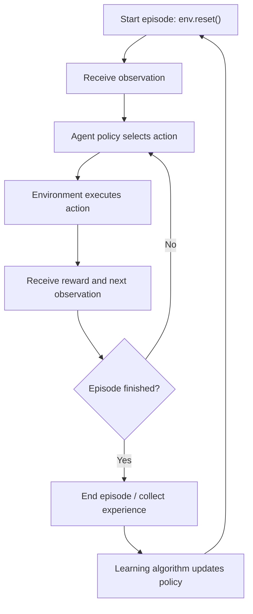
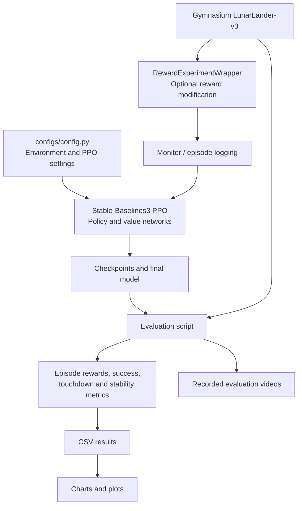
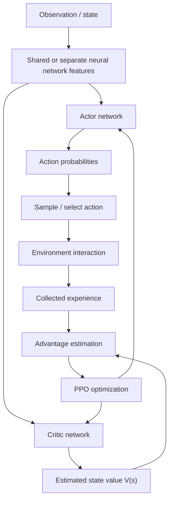
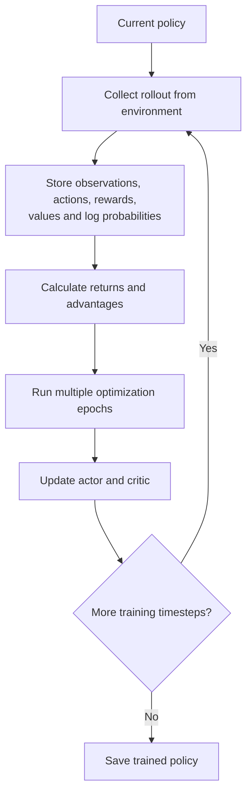
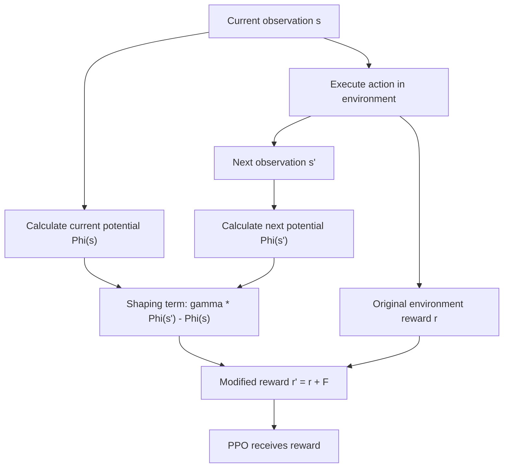
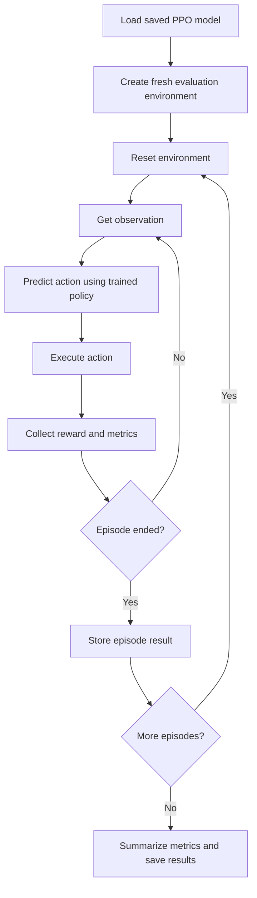
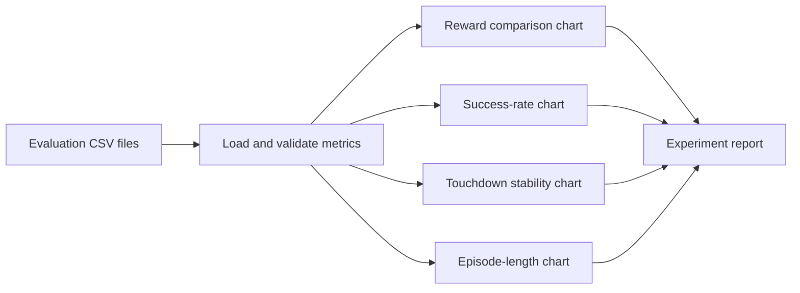

# Lunar Lander using Reinforcement Learning (PPO)

> A step-by-step reinforcement learning project that trains an autonomous spacecraft to control its descent and land on a platform using **Proximal Policy Optimization (PPO)**, with optional reward-shaping experiments and landing-stability evaluation.

---

## Table of Contents

1. [Project Overview](#1-project-overview)
2. [What We Are Trying to Solve](#2-what-we-are-trying-to-solve)
3. [Reinforcement Learning Fundamentals](#3-reinforcement-learning-fundamentals)
4. [The LunarLander-v3 Environment](#4-the-lunarlander-v3-environment)
5. [How the Complete System Works](#5-how-the-complete-system-works)
6. [Why PPO?](#6-why-ppo)
7. [Reward Design and Reward Shaping](#7-reward-design-and-reward-shaping)
8. [Project Structure](#8-project-structure)
9. [Installation and Setup](#9-installation-and-setup)
10. [Training the Agent](#10-training-the-agent)
11. [Evaluating a Trained Agent](#11-evaluating-a-trained-agent)
12. [Recording and Watching Videos](#12-recording-and-watching-videos)
13. [Understanding the Metrics](#13-understanding-the-metrics)
14. [Visualizing Results](#14-visualizing-results)
15. [Experiments and Comparisons](#15-experiments-and-comparisons)
16. [Troubleshooting](#16-troubleshooting)
17. [Limitations and Future Improvements](#17-limitations-and-future-improvements)
18. [How to Explain This?](#18-how-to-explain-this-project)

---

## 1. Project Overview

The goal of this project is to train an AI agent to land a spacecraft safely in the **Gymnasium `LunarLander-v3` simulation**.

Instead of writing a fixed set of rules such as "if the lander is falling quickly, activate the main engine", we train an agent through repeated interaction with a simulated environment.

The agent:

1. Receives numerical information about the lander's current state.
2. Chooses an action, such as firing an engine or doing nothing.
3. The environment simulates the resulting movement.
4. The agent receives a reward and a new observation.
5. A reinforcement learning algorithm uses experience to improve the agent's decision-making policy.

The main algorithm used is **Proximal Policy Optimization (PPO)**, implemented with Stable-Baselines3.

### Project goals

- Understand and implement a complete reinforcement learning workflow.
- Train an autonomous agent using PPO.
- Compare different reward configurations.
- Evaluate the model on episodes it did not use for gradient updates.
- Measure not only reward, but also landing success and touchdown stability.
- Record videos to inspect the agent's behaviour.

### Technologies

| Technology | Purpose |
|---|---|
| Python | Main programming language |
| Gymnasium | Lunar Lander simulation and RL environment API |
| Box2D | Physics simulation used by LunarLander |
| Stable-Baselines3 | PPO implementation |
| PyTorch | Neural network backend used by Stable-Baselines3 |
| NumPy | Numerical operations |
| Pandas | Evaluation result tables and CSV files |
| Matplotlib | Charts and result visualization |
| MoviePy / imageio dependencies | Video-related support, depending on the recording setup |

---

## 2. What We Are Trying to Solve

A spacecraft descending toward a landing pad must control its position, speed, and orientation.

A successful landing is not simply reaching the ground. The lander should approach the pad with manageable horizontal and vertical velocity and a reasonably upright orientation.

The simulation includes gravity, engine thrust, rotation, and collisions.

### The challenge

The agent must learn to:

- Move toward the landing area.
- Manage horizontal drift.
- Reduce downward speed before contact.
- Control its angle and angular velocity.
- Avoid crashing.
- Make a controlled landing.

A hand-written controller could attempt to solve this with manually designed rules. Reinforcement learning takes another approach: the agent learns a policy from trial-and-error interaction and reward feedback.

### Traditional programming versus reinforcement learning

**Rule-based approach**

```python
if vertical_velocity_is_too_negative:
    activate_main_engine()

if lander_is_tilted_left:
    correct_rotation()
```

This requires us to design and maintain the control rules.

**Reinforcement learning approach**

```text
Observation -> Policy -> Action -> Environment
      ^                            |
      |                            v
      +------ New observation + Reward
```

The policy learns which actions are useful in different states. It is not given a hard-coded instruction for every possible situation.

---

## 3. Reinforcement Learning Fundamentals

Reinforcement learning (RL) is a machine learning approach in which an **agent** learns to make decisions by interacting with an **environment**.

### 3.1 Agent

The agent is the decision-maker.

In this project, the agent is the PPO policy represented by a neural network. It receives an observation and selects an action.

### 3.2 Environment

The environment is the simulated world in which the agent acts.

Here, Gymnasium's `LunarLander-v3` environment handles the physics, engine controls, collisions, observations, and default rewards.

### 3.3 State and observation

A state describes the situation of the system at a particular time.

The environment provides the agent with an observation: a numerical representation of the lander's situation. For this task, the observation contains eight values.

| Index | Value | Meaning |
|---:|---|---|
| 0 | `x` | Horizontal position relative to the landing area |
| 1 | `y` | Vertical position |
| 2 | `vx` | Horizontal velocity |
| 3 | `vy` | Vertical velocity |
| 4 | `angle` | Lander orientation |
| 5 | `angular_velocity` | Rate of rotation |
| 6 | `left_leg_contact` | Whether the left leg is in contact |
| 7 | `right_leg_contact` | Whether the right leg is in contact |

The position and velocity values are normalized by the environment. They should not be interpreted directly as metres or metres per second.

Illustrative observation:

```python
observation = [
    0.15,    # horizontal position
    0.65,    # vertical position
    0.02,    # horizontal velocity
   -0.30,    # vertical velocity
    0.05,    # angle
    0.01,    # angular velocity
    0.0,     # left leg contact
    0.0      # right leg contact
]
```

These values are examples for understanding the format, not results from a particular training run.

### 3.4 Action

The default `LunarLander-v3` configuration uses a discrete action space with four actions.

| Action | Meaning |
|---:|---|
| 0 | Do nothing |
| 1 | Fire left orientation engine |
| 2 | Fire main engine |
| 3 | Fire right orientation engine |

The policy selects an action at each environment step. The environment applies it and returns the next observation.

### 3.5 Reward

A reward is numerical feedback from the environment.

- Positive reward generally indicates desirable progress or an achievement.
- Negative reward generally indicates an undesirable outcome or cost.

The default LunarLander reward accounts for factors such as movement toward the landing area, velocity, orientation, leg contact, landing/crashing, and engine usage.

The agent's objective is to learn a policy that maximizes **cumulative reward over time**, not merely the reward from one action.

### 3.6 Episode

An episode is one complete attempt.

It begins with `env.reset()` and ends when the environment reports either:

- `terminated=True`: a natural terminal event, such as a landing or crash.
- `truncated=True`: an external cutoff, commonly the time limit.

### 3.7 Policy

A policy is the agent's decision-making strategy.

We can write it conceptually as:

\[
\pi(a \mid s)
\]

This means: the policy determines the probability of choosing action \(a\), given state or observation \(s\).

### 3.8 The reinforcement learning loop



The environment interaction loop and the model-learning update are related, but they are not the same operation. The PPO algorithm collects batches of experience and then performs optimization updates using that experience.

---

## 4. The LunarLander-v3 Environment

The environment is created using Gymnasium:

```python
import gymnasium as gym

env = gym.make("LunarLander-v3")
observation, info = env.reset()
```

### What Gymnasium provides

- `gym.make(...)`: constructs the environment.
- `env.reset()`: starts a fresh episode and returns the initial observation.
- `env.step(action)`: applies an action and returns the next observation, reward, termination flags, and info.
- `env.close()`: releases environment resources.

Example interaction:

```python
observation, info = env.reset()

terminated = False
truncated = False

while not (terminated or truncated):
    action = env.action_space.sample()  # Random action for demonstration
    observation, reward, terminated, truncated, info = env.step(action)

env.close()
```

This example uses random actions. It demonstrates the environment API; it is **not** the trained PPO agent.

### Why start with random actions?

A random policy is a useful baseline for understanding the environment. It shows that merely interacting with the environment does not automatically produce intelligent behaviour.

The trained policy must learn from experience.

---

## 5. How the Complete System Works

At a high level, the project has five stages:

1. Configure the environment and PPO hyperparameters.
2. Create the environment and optional reward wrapper.
3. Train PPO using collected interactions.
4. Save the trained model.
5. Load the model and evaluate it in fresh episodes.

### System architecture



### Training versus evaluation

| Training | Evaluation |
|---|---|
| The algorithm learns and updates its policy. | The saved policy is tested. |
| Experience is collected for PPO updates. | The policy is normally used without gradient updates. |
| Training may use reward shaping. | The evaluation should report the original environment reward for fair comparison. |
| The model is saved. | Metrics and optional videos are produced. |

A model can perform well on training experience but poorly on new episodes. That is why evaluation is necessary.

---

## 6. Why PPO?

PPO stands for **Proximal Policy Optimization**. It is a policy-gradient reinforcement learning algorithm.

It is widely used because it provides a practical balance between implementation simplicity, training stability, and performance across many control tasks.

### 6.1 Policy-based learning

A policy-based algorithm learns a policy that maps observations to action probabilities.

For example, given an observation, the policy might produce probabilities similar to:

| Action | Illustrative probability |
|---|---:|
| Do nothing | 0.10 |
| Left engine | 0.15 |
| Main engine | 0.65 |
| Right engine | 0.10 |

These are illustrative numbers only. Actual probabilities depend on the trained policy and observation.

### 6.2 Actor and critic

PPO commonly uses an actor-critic architecture.

- **Actor:** decides which action to take.
- **Critic:** estimates how good the current state is, often represented by an estimated expected return \(V(s)\).



The exact internal network arrangement depends on the policy architecture and Stable-Baselines3 implementation. In this project, the configured policy is an MLP (multi-layer perceptron).

### 6.3 What is an advantage?

An advantage estimates whether an action performed better or worse than the critic expected.

Conceptually:

\[
A(s,a) = Q(s,a) - V(s)
\]

- \(Q(s,a)\): expected return after taking action \(a\) in state \(s\).
- \(V(s)\): expected return from state \(s\) under the policy.

A positive advantage suggests the action was better than expected. A negative advantage suggests it was worse than expected.

PPO uses advantage estimates to guide policy updates.

### 6.4 Why does PPO use clipping?

If a policy changes too much in one update, learning can become unstable.

PPO limits how much the new policy is allowed to differ from the old policy using a clipped objective.

A simplified expression is:

\[
L^{CLIP}(\theta) =
\mathbb{E}\left[
\min\left(
r_t(\theta)A_t,\;
\operatorname{clip}(r_t(\theta),1-\epsilon,1+\epsilon)A_t
\right)
\right]
\]

Where:

- \(\theta\): policy parameters.
- \(r_t(\theta)\): ratio between new and old action probabilities.
- \(A_t\): advantage estimate.
- \(\epsilon\): clipping range.

The clipping mechanism discourages excessively large policy updates. It does not guarantee that every training run will be stable or successful.

### 6.5 PPO training cycle



### 6.6 Hyperparameters

The project configuration includes PPO parameters similar to these:

| Parameter | Project setting | Meaning |
|---|---:|---|
| `learning_rate` | `3e-4` | Step size used by the optimizer |
| `n_steps` | `1024` | Steps collected per environment before an update |
| `batch_size` | `64` | Samples per minibatch |
| `n_epochs` | `10` | Optimization passes over a rollout |
| `gamma` | `0.99` | Discount factor for future rewards |
| `gae_lambda` | `0.95` | GAE bias/variance trade-off parameter |
| `clip_range` | `0.2` | PPO policy clipping range |
| `ent_coef` | `0.0` | Entropy regularization coefficient |

These are starting configuration values, not universally optimal values.

### What does the discount factor mean?

The discount factor \(\gamma\) controls how much future rewards contribute to current return estimates.

\[
G_t = r_t + \gamma r_{t+1} + \gamma^2r_{t+2} + \cdots
\]

With \(\gamma=0.99\), future rewards remain important, but their contribution decreases with distance into the future.

---

## 7. Reward Design and Reward Shaping

Reward design is important because the agent learns to optimize the objective represented by the reward.

The project supports multiple reward modes:

- `baseline`
- `hover`
- `shaped`
- `stable`

The exact implementation in `environments/reward_wrapper.py` is the source of truth for the formulas used in a particular version of the project.

### 7.1 Baseline reward

The baseline mode uses the reward supplied by the original Gymnasium environment without adding the project's custom reward terms.

This is the reference experiment.

### 7.2 Hover reward

The hover experiment adds an incentive for maintaining a small vertical velocity.

In the project version, the additional reward is applied when:

\[
|v_y| < 0.1
\]

This tests whether encouraging low vertical speed changes the agent's behaviour.

**Potential drawback:** hovering is not the same as landing. A reward that encourages hovering too strongly may teach the agent to remain airborne instead of completing a landing.

### 7.3 Potential-based reward shaping

The shaped mode uses a potential function \(\Phi(s)\) to estimate how desirable a state is.

A common potential-based shaping term is:

\[
F(s,s') = \gamma\Phi(s')-\Phi(s)
\]

The modified reward becomes:

\[
r'(s,a,s') = r(s,a,s') + F(s,s')
\]

Where:

- \(s\): current state.
- \(s'\): next state.
- \(\gamma\): discount factor.
- \(\Phi\): potential function.
- \(r\): original environment reward.

The intuition is to give feedback for moving from a less desirable state toward a more desirable state.

Potential-based shaping has policy-invariance results under particular assumptions. A custom implementation must respect those assumptions; arbitrary extra rewards do not automatically preserve the original optimal policy.

### 7.4 Stable landing reward mode

The stable mode is intended to encourage a controlled landing by assigning importance to quantities such as:

- Horizontal position relative to the pad.
- Horizontal velocity.
- Vertical velocity.
- Angle.
- Angular velocity.
- Leg contact.

An example of the project's potential cost is:

\[
C(s) =
1.25|x| + 0.20|y| + 0.90|v_x| +
1.00|v_y| + 1.00|\theta| +
0.35|\omega| - 0.25L
\]

Where:

- \(x,y\): normalized position.
- \(v_x,v_y\): normalized velocity.
- \(\theta\): angle.
- \(\omega\): angular velocity.
- \(L\): number of legs in contact (0, 1, or 2).

The potential may be defined as the negative cost:

\[
\Phi(s)=-C(s)
\]

**Important:** Use the actual formula in your checked-out `reward_wrapper.py` if it differs from this documented example. These are heuristic weights, not physical measurements of leg stress.

### 7.5 Reward shaping comparison

| Mode | Additional reward idea | Experiment question |
|---|---|---|
| `baseline` | No custom reward | How well does the default task reward work? |
| `hover` | Incentivize low vertical speed | Does a hover incentive change descent behaviour? |
| `shaped` | Potential difference between states | Does directional feedback help learning? |
| `stable` | Potential emphasizing controlled touchdown | Does the agent achieve more controlled contact? |

### Reward shaping flow



### Why evaluate with the original reward?

If each experiment changes the reward function, comparing its training reward directly can be misleading.

For a fairer comparison, evaluate all trained agents in the same unmodified environment and report the original environment reward alongside task-specific metrics.

---

## 8. Project Structure

The project is organized by responsibility:

```text
autonomous-lunar-lander/
│
├── configs/
│   └── config.py
│
├── environments/
│   ├── __init__.py
│   └── reward_wrapper.py
│
├── training/
│   └── train.py
│
├── evaluation/
│   └── evaluate.py
│
├── experiments/
│   └── run_experiments.py
│
├── visualization/
│   └── plot_results.py
│
├── models/
│   └── .gitkeep
│
├── logs/
│   └── .gitkeep
│
├── results/
│   └── .gitkeep
│
├── videos/
│   └── .gitkeep
│
├── requirements.txt
├── README.md
└── .gitignore
```

### Folder responsibilities

| Folder/file | Responsibility |
|---|---|
| `configs/config.py` | Environment ID, seed, PPO hyperparameters and default timesteps |
| `environments/reward_wrapper.py` | Custom reward logic for experiments |
| `training/train.py` | Creates the model, trains PPO, saves checkpoints and final model |
| `evaluation/evaluate.py` | Loads a model and evaluates episodes; can optionally render or record |
| `experiments/run_experiments.py` | Runs or organizes comparisons across reward modes |
| `visualization/plot_results.py` | Creates charts from saved experiment/evaluation data |
| `models/` | Saved PPO model files |
| `logs/` | Training logs and monitoring output |
| `results/` | CSV metrics and generated plots |
| `videos/` | Recorded evaluation videos |

The actual repository may contain additional files. Keep this section synchronized with the current directory tree.

---

## 9. Installation and Setup

### 9.1 Prerequisites

- Python 3.10 or 3.11 is a sensible compatibility choice for this project.
- Git (optional, for version control).
- A terminal.
- Internet access for installing packages.

### 9.2 Create the project environment

On Windows Command Prompt:

```cmd
python -m venv .venv
```

Activate it:

```cmd
.venv\Scripts\activate
```

Confirm which Python is active:

```cmd
where.exe python
python --version
```

The first Python path should point inside the project's `.venv` directory.

### 9.3 Install dependencies

Use the active virtual environment's Python to install packages:

```cmd
python -m pip install --upgrade pip
python -m pip install swig
python -m pip install "gymnasium[box2d]" "stable-baselines3[extra]" matplotlib pandas moviepy
```

If the project has a maintained `requirements.txt`, you can instead install from it:

```cmd
python -m pip install -r requirements.txt
```

On Windows, if `pip` points to a different Python installation, use the virtual environment interpreter explicitly:

```cmd
.venv\Scripts\python.exe -m pip install -r requirements.txt
```

### 9.4 Verify the installation

```cmd
python -c "import gymnasium, stable_baselines3, torch; print('Gymnasium:', gymnasium.__version__); print('SB3:', stable_baselines3.__version__); print('PyTorch:', torch.__version__)"
```

Test environment creation:

```cmd
python -c "import gymnasium as gym; env=gym.make('LunarLander-v3'); obs,info=env.reset(); print('Observation:', obs); print('Action space:', env.action_space); env.close()"
```

---

## 10. Training the Agent

Training is the process through which PPO collects experience and updates the policy.

### 10.1 Basic training command

From the project root, run:

```cmd
python training\train.py --mode baseline --timesteps 300000
```

If you are not sure the virtual environment is active, use:

```cmd
.venv\Scripts\python.exe training\train.py --mode baseline --timesteps 300000
```

### 10.2 Train each reward mode

```cmd
python training\train.py --mode baseline --timesteps 300000
python training\train.py --mode hover --timesteps 300000
python training\train.py --mode shaped --timesteps 300000
python training\train.py --mode stable --timesteps 300000
```

Run only modes that are present in the `choices` list in your current `training/train.py`. The stable mode requires the corresponding reward wrapper implementation.

### 10.3 What does `--timesteps` mean?

A timestep is one action-and-environment-transition step.

For example:

```cmd
python training\train.py --mode baseline --timesteps 300000
```

asks the training process to collect approximately 300,000 environment steps.

More timesteps can provide more learning experience, but do not guarantee better performance. Training time depends on hardware, environment speed, logging, and implementation.

### 10.4 What happens inside the training script?

The training script generally performs these steps:

1. Parse command-line arguments.
2. Create the Gymnasium environment.
3. Apply the selected reward wrapper.
4. Wrap the environment with a `Monitor` for episode logging.
5. Create a PPO model using the configured policy and hyperparameters.
6. Call `model.learn(...)`.
7. Save periodic checkpoints if a checkpoint callback is configured.
8. Save the final model.

Simplified example:

```python
import gymnasium as gym
from stable_baselines3 import PPO
from stable_baselines3.common.monitor import Monitor

env = gym.make("LunarLander-v3")
env = Monitor(env)

model = PPO(
    "MlpPolicy",
    env,
    learning_rate=3e-4,
    n_steps=1024,
    batch_size=64,
    n_epochs=10,
    gamma=0.99,
    gae_lambda=0.95,
    clip_range=0.2,
    verbose=1,
)

model.learn(total_timesteps=300_000)
model.save("models/lunar_lander_baseline")
env.close()
```

This is a simplified illustration of the training flow. Your actual `train.py` also handles command-line modes, reward wrappers, naming, and checkpointing.

### 10.5 What is `MlpPolicy`?

`MlpPolicy` means a policy based on a multi-layer perceptron: a feed-forward neural network.

The input is the observation vector. The network processes the values and produces the actor and critic outputs used by PPO.

The configured hidden layers in this project are:

```python
policy_kwargs = {
    "net_arch": {
        "pi": [64, 64],
        "vf": [64, 64]
    }
}
```

- `pi`: actor/policy network hidden layers.
- `vf`: critic/value network hidden layers.
- `[64, 64]`: two hidden layers with 64 units each.

### 10.6 Training output and saved files

Depending on the script's naming convention, model files should appear in `models/`, for example:

```text
models/
├── lunar_lander_baseline.zip
├── lunar_lander_hover.zip
├── lunar_lander_shaped.zip
└── lunar_lander_stable.zip
```

The exact names depend on the `--tag` option and the current training script.

Do not rename or overwrite a model until you have confirmed which training run it represents.

---

## 11. Evaluating a Trained Agent

Training and evaluation serve different purposes.

During evaluation, we load an existing model and test its behaviour over complete episodes.

### 11.1 Evaluate a model

```cmd
python evaluation\evaluate.py --model lunar_lander_baseline --episodes 20
```

The model argument should match the filename stem expected by your evaluation script. For example, if the file is `models\lunar_lander_baseline.zip`, use `lunar_lander_baseline`.

### 11.2 What does deterministic prediction mean?

Stable-Baselines3 can predict actions deterministically:

```python
action, _states = model.predict(observation, deterministic=True)
```

For a discrete policy, deterministic prediction generally chooses the action with the highest policy probability. This makes evaluation behaviour more repeatable for a fixed model and environment seed.

Stochastic prediction samples from the policy distribution and can be useful for exploring variability.

### 11.3 Evaluation loop



### 11.4 Why evaluate over multiple episodes?

One episode is not enough to understand performance.

The initial state, terrain conditions, and policy randomness can influence an episode. Evaluate over multiple episodes and report the number of episodes.

Useful measurements include:

- Mean episode reward.
- Standard deviation of reward.
- Success rate.
- Mean episode length.
- Touchdown stability metrics, if implemented.

A model that succeeds once may still be unreliable.

---

## 12. Recording and Watching Videos

Videos are useful for qualitative inspection. They help reveal behaviour that a single reward number cannot explain.

Examples of behaviours to inspect:

- Does the lander approach the pad?
- Does it oscillate or rotate excessively?
- Does it descend too quickly?
- Does it touch down with horizontal drift?
- Does it remain on the platform after contact?

### 12.1 Record evaluation episodes

If your current `evaluation/evaluate.py` supports the `--record` flag:

```cmd
python evaluation\evaluate.py --model lunar_lander_baseline --episodes 5 --record
```

The project version described here records up to five episodes when recording is enabled. Confirm the actual implementation in `evaluate.py`.

### 12.2 Watch the environment live

If the current evaluation script supports the `--human` flag:

```cmd
python evaluation\evaluate.py --model lunar_lander_baseline --episodes 5 --human
```

The human-rendered environment opens a window when the machine's display and rendering setup support it.

`--human` and `--record` may be separate modes in the script. Check its argument parser before combining them.

### 12.3 Expected video location

The evaluation script is configured to save recordings under a path similar to:

```text
videos/
└── lunar_lander_baseline/
    ├── episode-recording-1.mp4
    └── ...
```

The exact filenames and nested directory structure are generated by Gymnasium's `RecordVideo` wrapper and may differ.

### 12.4 Embed a video in this README

GitHub README files do not consistently render arbitrary local MP4 files as inline video players. A reliable approach is to upload the video to a GitHub issue, discussion, release, or another hosting service and link it.

For example, after uploading a demo video, add:

```markdown
## Demo Video

[Watch the Lunar Lander agent demonstration](PASTE_YOUR_VIDEO_LINK_HERE)
```

You can also add an animated GIF preview:

```markdown

```

Replace the placeholder with a real uploaded asset. Do not commit large raw videos to the repository unless you intentionally want the repository to store them; consider Git LFS or external hosting for large files.

---

## 13. Understanding the Metrics

A trained model should be assessed using more than one measurement.

### 13.1 Mean episode reward

For episode \(i\), let its total reward be \(R_i\).

For \(N\) evaluation episodes:

\[
\bar R = \frac{1}{N}\sum_{i=1}^{N}R_i
\]

A higher mean reward is generally better when the same reward definition and evaluation setup are used.

### 13.2 Reward standard deviation

\[
\sigma_R =
\sqrt{\frac{1}{N}\sum_{i=1}^{N}(R_i-\bar R)^2}
\]

A large standard deviation indicates more variation in episode rewards.

### 13.3 Success rate

If success is defined as episode reward greater than or equal to 200, then:

\[
\text{Success Rate} =
\frac{\text{Number of episodes with reward}\geq 200}
{N}\times100
\]

This is a project evaluation convention. Make sure the script's exact success definition is documented and used consistently.

### 13.4 Episode length

Episode length is the number of environment steps before termination or truncation.

A longer episode does not automatically mean better performance. The lander could be hovering, drifting, or simply taking longer to finish.

### 13.5 Touchdown stability

The stability extension records quantities around the first time both legs are simultaneously in contact.

Potential measurements include:

| Metric | Meaning | Why it matters |
|---|---|---|
| `touchdown_x_error` | Absolute horizontal position relative to pad | Indicates horizontal alignment |
| `touchdown_horizontal_speed` | Absolute horizontal velocity at touchdown | High drift can cause sliding |
| `touchdown_vertical_speed` | Absolute vertical velocity at touchdown | High descent speed can cause a hard landing |
| `touchdown_angle` | Absolute lander angle | Large tilt indicates poor orientation |
| `touchdown_angular_speed` | Absolute rotation speed | High rotation can destabilize contact |
| `both_legs_contact` | Whether both legs contact simultaneously | Indicates two-leg contact at the measured instant |

The values from the Gymnasium observation are normalized. These thresholds are heuristics, not universal physical safety limits.

A sample project heuristic might classify touchdown as stable when:

\[
|x|\leq0.20,\quad |v_x|\leq0.10,\quad
|v_y|\leq0.10,\quad |\theta|\leq0.10
\]

Use the exact thresholds in your current evaluation script.

### Important limitation: simulated leg damage

The standard Gymnasium LunarLander environment does not model detailed mechanical damage to landing legs. A stability score based on velocity, angle, and contact is a proxy for controlled touchdown. It is not a physical leg-stress or structural-damage calculation.

### 13.6 Touchdown versus final resting state

These are different measurements:

- **Touchdown metrics:** describe the lander at the first simultaneous two-leg contact.
- **Final-state metrics:** describe the lander at the end of the episode.

The lander may touch down gently and then slide or tip. Measuring both moments helps reveal that behaviour.

---

## 14. Visualizing Results

Charts help compare models and communicate the experiment.

Useful charts include:

1. Episode reward by evaluation episode.
2. Mean reward by reward mode.
3. Success rate by reward mode.
4. Touchdown horizontal and vertical speed.
5. Touchdown angle.
6. Training reward over timesteps, if training logs contain the necessary data.

### Suggested result chart layout



### Do not invent chart data

A chart should be generated from your actual CSV files. Do not put illustrative or fabricated values in a portfolio README and present them as measured results.

For each chart, state:

- Which models were compared.
- Number of evaluation episodes.
- Whether the evaluation environment used the original reward.
- What the success definition was.
- Whether the error bars represent standard deviation, standard error, or another quantity.

### Example chart captions

- **Episode reward:** Total original environment reward for each evaluation episode.
- **Mean reward:** Average original environment reward across the evaluation episodes.
- **Success rate:** Percentage of evaluation episodes meeting the stated success threshold.
- **Touchdown horizontal speed:** Absolute horizontal velocity at first simultaneous two-leg contact.
- **Touchdown angle:** Absolute lander angle at first simultaneous two-leg contact.

If `visualization/plot_results.py` expects particular filenames or columns, use its actual interface and update these instructions to match it.

---

## 15. Experiments and Comparisons

The project is designed to compare reward strategies under a consistent setup.

### 15.1 Experiment matrix

| Experiment | Reward mode | Main question |
|---|---|---|
| A | Baseline | How does the agent perform with the environment's default reward? |
| B | Hover | Does a low-vertical-speed incentive alter descent behaviour? |
| C | Shaped | Does potential-based feedback improve learning? |
| D | Stable | Does a landing-focused potential improve touchdown control? |

### 15.2 Keep comparisons fair

For a meaningful comparison:

- Use the same environment version.
- Use the same evaluation success definition.
- Evaluate each model over the same number of episodes.
- Use consistent evaluation settings.
- Record random seeds.
- Report the exact training timesteps.
- Evaluate with the original environment reward.
- Keep the model files and CSV outputs clearly named.

A single run per mode is not enough to establish that one reward design is consistently superior. For stronger evidence, repeat training with multiple seeds and report averages and variability across runs.

### 15.3 Experiment record template

| Field | Value to record |
|---|---|
| Experiment name | e.g. `stable_seed42_300k` |
| Reward mode | baseline / hover / shaped / stable |
| Training timesteps | Actual number used |
| Random seed | Actual seed |
| PPO configuration | Learning rate, rollout length, batch size, etc. |
| Evaluation episodes | Actual number |
| Mean reward | From evaluation CSV |
| Success rate | From evaluation output |
| Stable touchdown rate | If available |
| Video path | Path to saved recording |
| Notes | Observed behaviour and issues |

### 15.4 Results table template

Fill this table with actual measured results:

| Model | Timesteps | Evaluation episodes | Mean reward | Success rate | Stable touchdown rate |
|---|---:|---:|---:|---:|---:|
| Baseline | — | — | — | — | — |
| Hover | — | — | — | — | — |
| Shaped | — | — | — | — | — |
| Stable | — | — | — | — | — |

---

## 16. Troubleshooting

### `ModuleNotFoundError: No module named 'gymnasium'`

The package may have been installed into a different Python interpreter.

Check:

```cmd
where.exe python
where.exe pip
```

Then install using the project's virtual environment interpreter:

```cmd
.venv\Scripts\python.exe -m pip install "gymnasium[box2d]" "stable-baselines3[extra]"
```

### `pip` is not recognized

Use:

```cmd
.venv\Scripts\python.exe -m ensurepip --upgrade
.venv\Scripts\python.exe -m pip install --upgrade pip
```

### Box2D or SWIG installation errors

Try installing SWIG first:

```cmd
.venv\Scripts\python.exe -m pip install swig
.venv\Scripts\python.exe -m pip install "gymnasium[box2d]"
```

If the error persists, check the Python version and the Gymnasium installation instructions for the operating system.

### Video is not saved

Confirm that:

1. The command includes `--record`.
2. `evaluate.py` actually defines and handles the `--record` argument.
3. The evaluation code creates a `RecordVideo` wrapper.
4. The process completes and closes the environment.
5. You inspect the configured `videos/` output directory.

Example:

```cmd
python evaluation\evaluate.py --model lunar_lander_baseline --episodes 5 --record
```

Running evaluation without `--record` normally does not create a video.

### Live window does not appear

Check that:

- The script supports a `--human` option.
- The environment is created with `render_mode="human"`.
- The machine supports graphical rendering.
- You are not running in a headless terminal/session.

### Model file not found

Check the exact filename in `models/`:

```cmd
dir models
```

Pass the model name in the format expected by `evaluate.py`. Some scripts expect the filename without `.zip`; others may accept a full path.

### Evaluation is poor

Possible reasons:

- Too few training timesteps.
- Reward design encourages an unintended behaviour.
- Model was not trained successfully.
- Evaluation uses a different model than intended.
- Results vary between episodes.
- Hyperparameters or random seeds need experimentation.

Do not assume that simply increasing timesteps will always fix the issue. Inspect reward curves, episode videos, and evaluation metrics.

---

## 17. Limitations and Future Improvements

### Current limitations

- The environment is a simplified 2D simulation, not a realistic lunar landing simulator.
- The agent receives numerical observations rather than camera images.
- The default environment has a fixed landing area and does not represent arbitrary terrain.
- The standard environment does not model detailed landing-leg structural damage.
- Reward shaping is heuristic and may introduce unintended incentives.
- A limited number of evaluation episodes provides uncertain evidence of general performance.
- One training seed cannot establish reproducibility.

### Future improvements

#### Reinforcement learning

- Compare PPO with A2C or other suitable algorithms.
- Tune learning rate, rollout size, batch size, and network architecture.
- Train with multiple random seeds.
- Add a systematic hyperparameter search.

#### Reward engineering

- Test different potential functions.
- Measure the trade-off between landing success and touchdown quality.
- Avoid rewarding hovering when the actual goal is a completed landing.
- Track both touchdown and final resting stability.

#### Environment improvements

- Explore custom terrain or varied landing-pad positions.
- Add wind or disturbance experiments.
- Investigate more realistic physics and contact models.
- Consider a continuous-control environment if testing continuous engine output is a goal.

#### Evaluation and reporting

- Add confidence intervals across multiple runs.
- Plot learning curves from training logs.
- Compare models using a shared evaluation protocol.
- Automate experiment tracking.
- Create a reproducible results report with model, configuration, seed, and metrics.

---

## 18. How to Explain This Project?

### Short project introduction

"I built an autonomous Lunar Lander agent using reinforcement learning. The goal was to train a simulated spacecraft to land safely by learning from interactions with the environment rather than relying on manually written control rules. I used Gymnasium's LunarLander environment and trained a PPO agent with Stable-Baselines3. I also explored reward shaping and landing-stability metrics to evaluate not only whether the lander completed the task, but also how controlled its touchdown was."

### Explain the architecture

"The environment provides an eight-dimensional observation containing position, velocity, angle, angular velocity, and landing-leg contact. The PPO policy processes this observation and selects one of four discrete engine actions. Gymnasium applies the action and returns the next observation and reward. PPO collects these interactions and updates its actor and critic networks."

### Explain why PPO

"I selected PPO because it is a practical policy-gradient algorithm that uses a clipped objective to discourage excessively large policy updates. Its actor-critic structure learns both an action policy and a value estimate, which helps calculate advantages for policy optimization."

### Explain reward shaping

"I compared the default environment reward with custom reward modes. The potential-based shaping experiment added a reward term based on the difference between the potential of the next and current states. I also experimented with incentives related to low vertical velocity and controlled touchdown. I evaluated the resulting agents using the original environment reward and additional landing metrics so that custom training rewards would not be confused with task performance."

### Explain a challenge

"One challenge was that a high episode reward alone does not fully describe landing quality. A lander may touch the platform while moving sideways or at an angle. I therefore added touchdown measurements such as horizontal speed, vertical speed, angle, and two-leg contact. These are heuristic stability indicators; the standard simulator does not model actual landing-leg damage."

### Be precise about results

Do not claim that the agent achieved a particular success rate or outperformed another mode unless your saved evaluation results support that statement.

Be ready to explain:

- Training timesteps.
- Number of evaluation episodes.
- Mean reward and standard deviation.
- Success-rate definition.
- Reward modes tested.
- What the videos revealed.
- Limitations of the simulator and stability heuristic.

---

## References

- [Gymnasium documentation](https://gymnasium.farama.org/)
- [Gymnasium LunarLander documentation](https://gymnasium.farama.org/environments/box2d/lunar_lander/)
- [Stable-Baselines3 documentation](https://stable-baselines3.readthedocs.io/)
- [Stable-Baselines3 PPO documentation](https://stable-baselines3.readthedocs.io/en/master/modules/ppo.html)
- [Proximal Policy Optimization Algorithms — Schulman et al. (2017)](https://arxiv.org/abs/1707.06347)

---

## License

MIT

---

**Final note:** This README explains the intended architecture and workflow. Keep commands, reward formulas, model filenames, CSV columns, chart outputs, and video paths synchronized with the actual code in your repository. The results section should contain only measurements produced by your own experiments.
